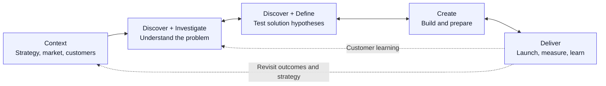

# Productside Playbook skills and prompts

Practical help for product discovery, strategy, planning, and learning, based on the Productside Playbook.

## Start with a prompt

1. [Choose a task](prompts/README.md), such as preparing customer interviews or checking a positioning statement.
2. Open a prompt and copy the text inside the box into your AI chat.
3. Bring your context, answer the questions, and keep the work you agree with.

Nothing to install. You do the thinking, and AI pressure-tests it.

Choose **Guided** to complete the work while learning the method step by step, with context-relevant recommendations. Choose **Expert** to bring your context and get the result, asking for guidance on any step when needed. Choose **Discovery** to synthesize missing context and quickly sketch or simulate a walkthrough with assumptions clearly labeled. You can switch modes as you work.

## Use a skill

[Browse the 25 skills](skills/README.md) for guided help across all 24 Playbook Plays. Each Play is one `SKILL.md` file containing its instructions, working template, examples, and quality checks.

For a chat, attach the chosen Play's `SKILL.md`, then ask:

> Help me apply this Play to [my product and customer]. Walk me through it one question at a time.

## Use the library in a ChatGPT Project

[Set up a ChatGPT Project](chatgpt-project/README.md) with three source files and project instructions. The Play guide routes you to coaching prompts or the full skill references, including their templates and examples. No skill installation is needed.

## How the Plays fit together

The **Productside Blueprint** connects strategy and customer understanding to discovery, creation, and learning. Start where your work needs help. Phases can overlap, and new evidence can send you back to an earlier question.

Use the Plays to examine evidence and make decisions throughout this cycle. Discovery continues after launch.

## About this copy

This is Dean Peters's minimal adaptation of the [Productside library](https://github.com/Productside/Productside-Playbook-Skills). Each Play is one file; standalone prompts live in `prompts/`. Expanded examples, source excerpts, and maintenance documentation remain in the original project.

Copied from the source project's local working tree on November 19, 2026, including its uncommitted library updates. Content follows the November 2026 B2B work-in-progress Playbook, which is not yet ratified. AI-generated customer details and numbers are assumptions to validate.

Based on materials from Productside, licensed under CC BY-NC-SA 4.0 with Additional Internal Business Use Permissions. See [LICENSE](LICENSE) for permissions and restrictions.
