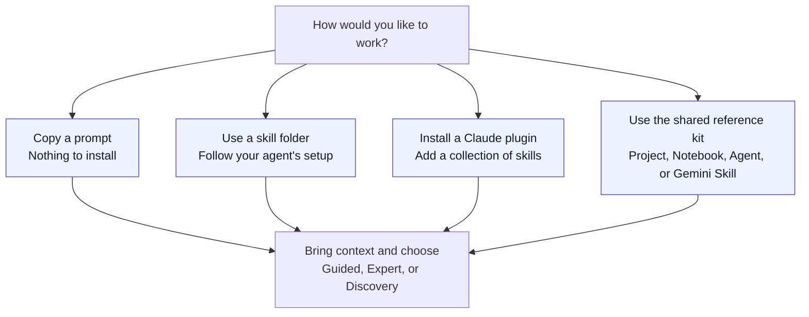
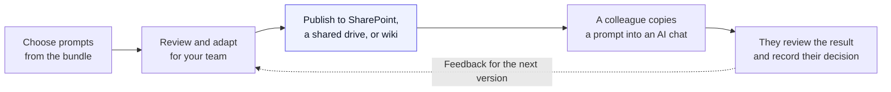
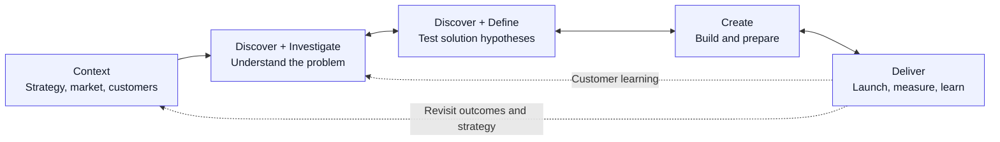

# Productside Playbook skills and prompts

Practical help for product discovery, strategy, planning, and learning, based on the Productside Playbook.

You can use this library from your browser. You do not need to write code, use Terminal, or learn GitHub first. Start with one task and one AI conversation.

A **Play** is an exercise that helps you work through a product question. A **prompt** is text you copy into your AI chat. A **skill** gives the assistant a Play's full method and template.

## Start with a prompt

1. [Choose a task](prompts/README.md), such as preparing customer interviews or checking a positioning statement.
2. Open a prompt and copy the text inside the box into your AI chat.
3. Bring your context, answer the questions, and keep the work you agree with.

On a prompt page, copy only the text inside the large text box, using its copy button if shown. Leave the title and notes outside the box.

Nothing to install. You do the thinking, and AI pressure-tests it.

Choose **Guided** to complete the work while learning the method step by step, with context-relevant recommendations. Choose **Expert** to bring your context and get the result, asking for guidance on any step when needed. Choose **Discovery** to synthesize missing context and quickly sketch or simulate a walkthrough with assumptions clearly labeled. You can switch modes as you work.

## Use a skill

[Browse the 25 skills](skills/README.md) for guided help across all 24 Playbook Plays. Each Play is one `SKILL.md` file containing its instructions, working template, examples, and quality checks.

To try one, open its link, then use **Download raw file** (the down-arrow button near the file). `SKILL.md` is a text document; you do not need to edit it. Attach the downloaded file to your AI chat, then ask:

> Help me apply this Play to [my product and customer]. Walk me through it one question at a time.

## Use the library in a project, notebook, or assistant

[Use the shared reference kit](projects/README.md) in a Claude Project, ChatGPT Project, Microsoft 365 Copilot Notebook or Agent, or Gemini Skill (formerly Gem). The setup guide explains each tool's file and instructions options.

## Find the right download or setup

[Start with the downloads guide](downloads/README.md) for skill-and-prompt bundles, Claude plugin ZIPs, and the shared Project kit. It explains the paths for Claude, ChatGPT, Microsoft 365 Copilot, Gemini, Cursor, and other assistants.

## Choose a way to use the library

[Prompts](prompts/README.md) · [Skill folders](skills/README.md) · [Claude plugin ZIPs](downloads/plugins/README.md) · [Project reference kit](projects/README.md)

## Share a prompt library with your team

A shared folder of prompts can be enough. Unpack the [full-library bundle](downloads/bundles/README.md), review its `prompts/` folder, and place the prompts your team wants in an approved SharePoint document library, shared drive, or wiki. Add a simple index by task and link colleagues to it.

Name an owner for updates and keep source labels, assumptions, and Productside attribution visible. A shared prompt library provides copy-and-paste access; connecting an agent or notebook to it is a separate setup. Keep your organization's private context out of the reusable public files.

## How the Plays fit together

The **Productside Blueprint** connects strategy and customer understanding to discovery, creation, and learning. Start where your work needs help. Phases can overlap, and new evidence can send you back to an earlier question.

Use the Plays to examine evidence and make decisions throughout this cycle. Discovery continues after launch.

## From training to everyday product work

Born out of the **Productside Playbook**, this library turns its Plays, templates, and Productside Blueprint into prompts and reusable AI skills for everyday product work. It carries the Playbook's reasoning into the conversation: understand the customer, examine the evidence, connect work to outcomes, and make deliberate decisions.

The library complements Productside's **Optimal Product Management (OPM)** and **AI Product Management** training by helping you apply what you learn to your own product and team. Use it during exercises, revisit a method after class, or bring a Play into your next discovery, strategy, or planning conversation.

**Guided** helps you learn and complete the method with coaching. **Expert** helps you put a familiar method to work with the context you already have. **Discovery** helps you explore a provisional sketch when context is incomplete. In every mode, you do the thinking and own the decisions; AI helps you practice, structure, and pressure-test the work.

Content follows the November 2026 work-in-progress Playbook. Treat AI-generated customer details and numbers as assumptions to validate.

Based on materials from Productside, licensed under CC BY-NC-SA 4.0 with Additional Internal Business Use Permissions. See [LICENSE](LICENSE) for permissions and restrictions.
