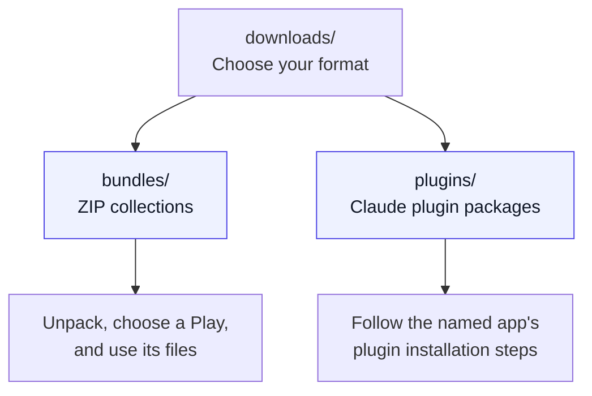

# Use the Productside Playbook with your AI assistant

Get help with customer discovery, strategy, planning, and learning. A **Play** is a guided exercise for a piece of product work. A **skill** gives your AI assistant the Play's method, template, examples, and quality checks in one file.

**New here? Start with a [copy-and-paste prompt](../prompts/README.md).** Nothing to install and no coding required.

**Start with a ZIP:** [full skills-and-prompts bundle](https://github.com/deanpeters/ps-playbook-skills/raw/main/downloads/bundles/psk-bundle-full-library.zip), [shared Project kit](https://github.com/deanpeters/ps-playbook-skills/raw/main/downloads/bundles/psk-project-kit.zip), or [Claude plugin choices](plugins/README.md). Choose a bundle if you want files to open and use yourself. Choose a plugin if you want to add skills through Claude's Plugins page.

## Download and open a ZIP

Click a download link and look in your computer's Downloads folder. On a Mac, double-click a bundle ZIP to open it. On Windows, right-click it and choose **Extract All**. You can then browse its folders like any other documents.

For a Claude plugin, keep the ZIP closed: Claude's upload option takes the ZIP itself. You do not need GitHub's green **Code** button or a copy of the whole library to get started.

## Try a Play in about five minutes

1. [Choose a task](../prompts/README.md), such as preparing interviews or checking your positioning.
2. Open its first prompt and copy everything in the text box into a new AI chat.
3. Replace bracketed placeholders with your context. Choose **Guided** if you want to learn the process step by step.
4. Answer the first question. If you do not have enough context yet, ask for **Discovery** to get a provisional sketch with assumptions labeled.

Review what the assistant suggests and record what you decide to keep. You do the thinking; AI pressure-tests it.

## Choose the route that fits your tool

| I use... | Start here | What to expect |
|---|---|---|
| Claude in a browser or the Claude desktop app | [Prompts](../prompts/README.md) or [Claude Project](../projects/README.md#claude-project) | Paste a prompt or add the reference kit to a Project. See [Claude plugins](plugins/README.md) for installable package ZIPs. |
| ChatGPT | [ChatGPT Project setup](../projects/README.md#chatgpt-project) | Add three source files and paste the compact Project instructions. For a single task, use a prompt instead. |
| Microsoft 365 Copilot | [Notebook or Agent setup](../projects/README.md#microsoft-365-copilot-notebook) | Add reference documents and instructions; the guide covers plain-text copies for Agent uploads. |
| Gemini Skills, formerly Gems | [Gemini setup](../projects/README.md#gemini-skills-formerly-gems) | Create a library skill manually with the reference documents, or upload a single Play's SKILL.md. |
| Cursor | [Skill files and Cursor steps](bundles/README.md#cursor) | Start with a prompt in Agent chat, or add a chosen skill folder to your project. |
| Claude Code or another assistant that supports skill folders | [Skills library](../skills/README.md) | Use the complete `psk-...` folder and follow your tool's installation instructions. |
| Another AI chat | [Prompts](../prompts/README.md) | Copy a prompt. If your tool accepts Markdown attachments, you can also give it a Play's `SKILL.md`. |

ChatGPT Projects share uploaded sources and instructions across their chats. See [OpenAI's Projects guide](https://learn.chatgpt.com/docs/projects). Cursor's skill-folder route is documented in [Cursor's Agent Skills guide](https://cursor.com/docs/skills). Plugin support and upload options depend on the target app; see [Claude's plugin guide](https://support.claude.com/en/articles/13837440-use-plugins-in-claude).

## How the downloads are organized

A **ZIP** is one downloadable file containing other files. A **bundle** collects skills and prompts for you to unpack. A **plugin** packages skills for installation in a particular assistant.

- [Bundles](bundles/README.md): skills and prompts by Blueprint phase, the full library, and a shared Project reference kit.
- [Plugins](plugins/README.md): Claude plugin packages by phase and for the full library. Other plugin formats need separate compatibility checks.

## Choose how you want help

- **Guided:** learn and complete the work one step at a time, with context-relevant recommendations.
- **Expert:** bring your context and ask for the result; get guidance on any step when needed.
- **Discovery:** synthesize missing context and sketch or simulate a walkthrough, with assumptions visible.

You can switch modes during the conversation. A simulation is not customer research or a team decision.

## Need a hand?

If the assistant cannot find a skill by name, [open its SKILL.md](../skills/README.md), attach it or paste its contents, and ask:

> Use the attached Play to help with [my product and customer]. Start in Guided mode. Ask one question at a time and help me record the result in the embedded template.

For a ChatGPT Project, follow the three-file setup rather than trying to install a Claude plugin there. Before sharing a Project, check what its participants can access.

These materials follow the November 2026 work-in-progress Playbook, which is not yet ratified. Review the [Productside license](../LICENSE) before redistributing materials or using them in a commercial offering.

The download files have been checked for completeness. Installation and responses in live AI accounts still need testing; try one Play before sharing a setup with your team.

[Back to the main guide](../README.md) · [For people maintaining these files](MAINTAINING.md)
