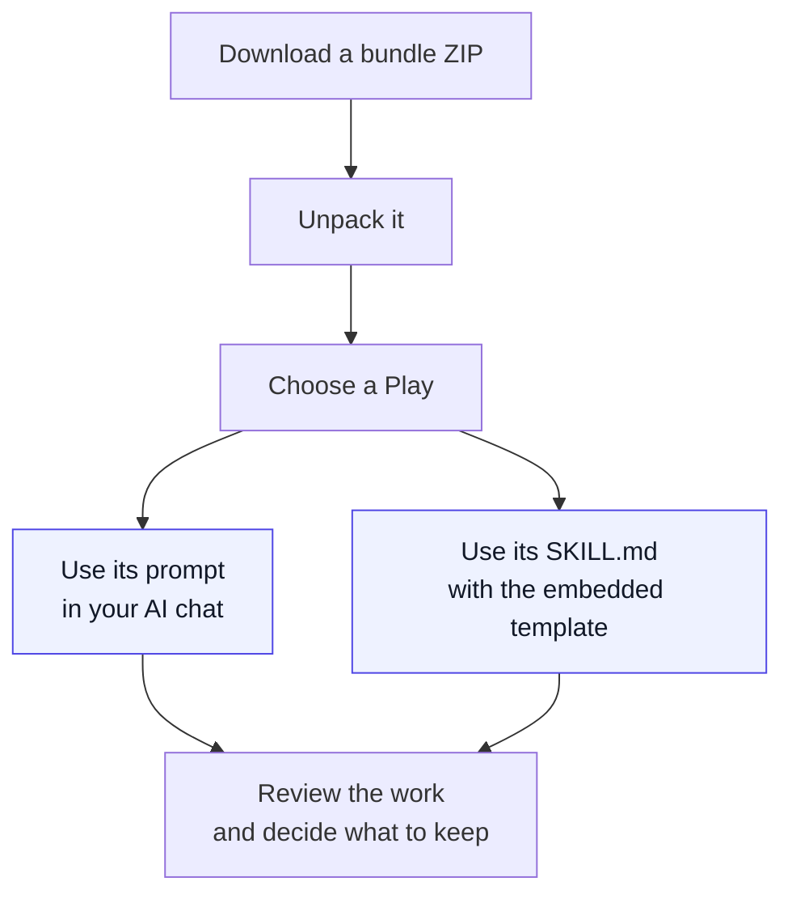

# Skill and prompt bundles

A bundle collects related Productside Playbook skills and prompts in one ZIP file. You unpack it and choose the files you want to use. Each skill is one `SKILL.md` containing the method, working template, examples, and quality checks.

**Recommended first download:** [Full library ZIP](https://github.com/deanpeters/ps-playbook-skills/raw/main/downloads/bundles/psk-bundle-full-library.zip). For a reusable Claude/ChatGPT Project, Copilot Notebook or Agent, or Gemini Skill, get the [Project kit ZIP](https://github.com/deanpeters/ps-playbook-skills/raw/main/downloads/bundles/psk-project-kit.zip) and follow its platform setup guide.

## Download a collection

Start with the Blueprint phase that matches the work in front of you. You do not need the full library to try one Play.

| Collection | What it helps you do | Skills | Prompts | Download |
|---|---|---:|---:|---|
| Context | Agree on outcomes, stakeholders, and your market | 4 | 8 | [ZIP](https://github.com/deanpeters/ps-playbook-skills/raw/main/downloads/bundles/psk-bundle-context.zip) |
| Discover + Investigate | Understand customers and frame their problems | 6 | 9 | [ZIP](https://github.com/deanpeters/ps-playbook-skills/raw/main/downloads/bundles/psk-bundle-discover-investigate.zip) |
| Discover + Define | Explore solutions and test assumptions | 7 | 11 | [ZIP](https://github.com/deanpeters/ps-playbook-skills/raw/main/downloads/bundles/psk-bundle-discover-define.zip) |
| Create | Plan work, prioritize, and prepare for launch | 5 | 7 | [ZIP](https://github.com/deanpeters/ps-playbook-skills/raw/main/downloads/bundles/psk-bundle-create.zip) |
| Deliver | Measure outcomes and learn from delivery | 2 | 2 | [ZIP](https://github.com/deanpeters/ps-playbook-skills/raw/main/downloads/bundles/psk-bundle-deliver.zip) |
| Full library | Use every phase plus the Blueprint navigator | 25 | 38 | [ZIP](https://github.com/deanpeters/ps-playbook-skills/raw/main/downloads/bundles/psk-bundle-full-library.zip) |

The Outcome Tree skill includes Sections One and Two and is included in Context and the full library; Section Two also supports Deliver work. The Blueprint navigator is included in the full library. Each bundle includes matching prompts, the license, and a short usage guide. Context includes both Outcome Tree prompts, including the Section Two prompt used later in Deliver.

## How a bundle works

On a Mac, double-click a ZIP to unpack it. On Windows, right-click it and choose **Extract All**. An ordinary bundle is a file collection; follow your assistant's separate instructions if you want to install its skills.

## Use the files available today

### Claude or another AI chat

For the fastest route, [choose a prompt](../../prompts/README.md) and paste its copyable text into your chat. For a fuller walkthrough, [choose a skill](../../skills/README.md) and supply its `SKILL.md` through a supported attachment or pasted text. Ask the assistant to use its embedded template.

If you want to install several skills together in Claude, use a [Claude plugin ZIP](../plugins/README.md) and follow its installation steps.

### Claude Projects, ChatGPT, Copilot, and Gemini

For repeated use, download the [Project kit ZIP](https://github.com/deanpeters/ps-playbook-skills/raw/main/downloads/bundles/psk-project-kit.zip). It contains the three compiled references, compact instructions, full Markdown instructions, setup guide, and trial checklist. Follow the [platform-specific setup](../../project/README.md) for Claude Projects, ChatGPT Projects, Microsoft 365 Copilot Notebooks or Agents, and Gemini Skills (formerly Gems). Adding sources and setting instructions are separate steps. Microsoft Agent uploads use plain-text copies as explained in that guide.

### Cursor

You can paste a prompt into Agent chat without installing a skill. If you want Cursor to discover a skill in your project:

1. [Choose a skill](../../skills/README.md) and save its complete `psk-...` folder, including `SKILL.md`.
2. In the project you open in Cursor, place that folder inside `.cursor/skills/`. Keep the skill folder name unchanged.
3. The resulting path should look like `.cursor/skills/psk-framing-the-problem/SKILL.md`.
4. Open a new Agent chat and ask:

   > Use psk-framing-the-problem for [my product and customer]. Guide me through it one step at a time.

Cursor documents project-level skill folders in its [Agent Skills guide](https://cursor.com/docs/skills). Cursor installation has not yet been tested with this library. If the skill is not found, supply the file's contents directly or use the prompt route.

### Another assistant that supports skills

Use the `psk-...` skill folder in the location your assistant documents. A bundle does not install itself, and a plugin intended for a different app may use a different format.

[All download options](../README.md) · [Skills library](../../skills/README.md) · [License](../../LICENSE)

## Share prompts without installing skills

The full-library ZIP includes all 38 files under prompts/. Copy that folder into an approved SharePoint document library, shared drive, or wiki. Add an index organized by task, keep attribution and source labels, and name an owner for updates. Colleagues can open a prompt and paste its copyable box into their chosen AI chat. This does not automatically connect or install anything in that assistant.

## Validation and updates

All seven bundle ZIPs pass integrity and source-content checks. The six skill collections preserve source skills and prompts; the Project kit preserves the three generated references and adjusts the setup guide's repository link for use outside this repository. Live assistant setup and behavior remain unverified. Re-download after an update; extracted copies do not update themselves.
