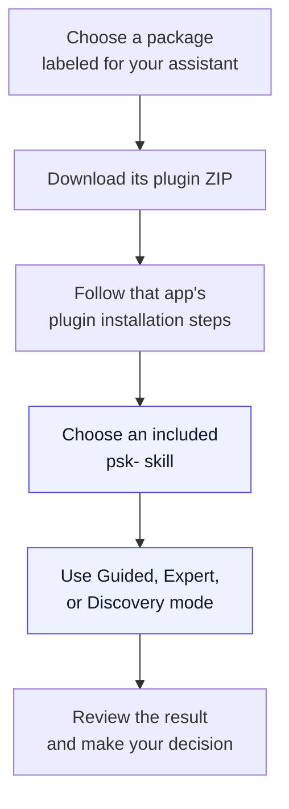

# Plugin packages

A plugin is an installable package for a particular AI assistant. These Claude packages bring a collection of Productside Playbook skills into Claude so you can ask for the work by skill name.

**Start with the [full-library Claude plugin ZIP](https://github.com/deanpeters/ps-playbook-skills/raw/main/downloads/plugins/psk-plugin-full-library.zip)**, or choose a phase below. Download the ZIP to your computer, then follow **Add a package to Claude** below. Keep the ZIP closed for upload. For a no-install route, [paste a prompt](../../prompts/README.md).

## Is a plugin the right choice?

| You want to... | Use this route |
|---|---|
| Add a collection of skills to Claude | Choose a Claude plugin ZIP below. |
| Use the library in a Claude/ChatGPT Project, Copilot Notebook or Agent, or Gemini Skill | Follow the [shared reference kit setup](../../projects/README.md) with three sources and compact instructions. |
| Use skills in Cursor or another assistant | Follow the [file-based skill guidance](../bundles/README.md#cursor) or that assistant's own installation instructions. |
| Try one exercise immediately | [Paste a prompt](../../prompts/README.md) into your AI chat. |
| Get files to unpack and choose yourself | See the [bundles](../bundles/README.md). |

Claude supports custom plugin uploads and plugin use across its supported chat, Cowork, and Claude Code surfaces; availability depends on account and workspace settings. See [Claude's plugin guide](https://support.claude.com/en/articles/13837440-use-plugins-in-claude). A package's download page will identify which surfaces have actually been tested.

## Download a Claude plugin

| Collection | Skills | Download |
|---|---:|---|
| Context | 4 | [ZIP](https://github.com/deanpeters/ps-playbook-skills/raw/main/downloads/plugins/psk-plugin-context.zip) |
| Discover + Investigate | 6 | [ZIP](https://github.com/deanpeters/ps-playbook-skills/raw/main/downloads/plugins/psk-plugin-discover-investigate.zip) |
| Discover + Define | 7 | [ZIP](https://github.com/deanpeters/ps-playbook-skills/raw/main/downloads/plugins/psk-plugin-discover-define.zip) |
| Create | 5 | [ZIP](https://github.com/deanpeters/ps-playbook-skills/raw/main/downloads/plugins/psk-plugin-create.zip) |
| Deliver | 2 | [ZIP](https://github.com/deanpeters/ps-playbook-skills/raw/main/downloads/plugins/psk-plugin-deliver.zip) |
| Full library | 25 | [ZIP](https://github.com/deanpeters/ps-playbook-skills/raw/main/downloads/plugins/psk-plugin-full-library.zip) |

Each package includes the selected skills, license, and a short guide. The full library adds the Blueprint navigator to help you choose a Play. Skill names begin with `psk-` so you can recognize them in Claude. Claude may show a package name alongside them.

## Add a package to Claude

1. Download one ZIP from the table. Keep it zipped for the custom-plugin upload flow.
2. Open Claude's **Plugins** page. If your account still shows **Customize**, use its Plugins area.
3. Use the custom-plugin upload option to select the ZIP. Complete the installation and check that its skills are available.
4. Start a fresh conversation and choose a skill included in that collection.

The exact upload option depends on your account and workspace policy. See [Claude's plugin guide](https://support.claude.com/en/articles/13837440-use-plugins-in-claude) and [interface migration guide](https://support.claude.com/en/articles/17740565-manage-plugins-skills-and-connectors-from-one-plugins-page). If custom uploads are unavailable, use a bundle's files or the prompt route. Use the ZIP upload route for these packages; they are not listed in a plugin store.

After an installed package's skills are visible, an example request is:

> Use psk-outcome-tree to help me connect [my product's customer outcomes] to [our business outcome]. Start in Guided mode and ask one question at a time.

For a phase package, use a skill included in that collection. If the assistant cannot find it, check that the package is enabled and consult that tool's plugin guide. You can still use a prompt or supply the individual `SKILL.md` directly.

[All download options](../README.md) · [Bundles](../bundles/README.md) · [License](../../LICENSE)

## What has been checked

All six packages have been checked for complete files and a format Claude recognizes. Installing them in a live account and using their skills still need testing. Try one Play before sharing a setup with your team. These packages provide instructions for your assistant; they do not connect to your company's systems. Technical validation details are in the [maintenance notes](../MAINTAINING.md).
