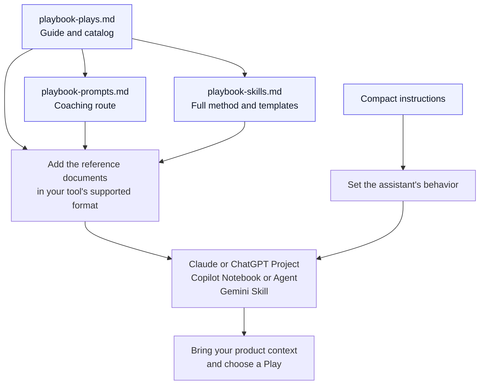

# Use the Playbook in your project, notebook, or assistant

Keep the Productside Playbook alongside your product work in a **Claude Project**, **ChatGPT Project**, **Microsoft 365 Copilot Notebook or Agent**, or **Gemini Skill (formerly Gem)**. The same reference documents support coaching prompts and full Play walkthroughs.

**Start with your tool below.** You do not need to code or install a plugin to use this reference kit. Account features, file support, and sharing controls differ; these are documented setup routes, not completed installation tests.

## What you need

| File | What it does |
|---|---|
| [playbook-plays.md](uploads/playbook-plays.md) | Start here: choose a Play, then follow its prompt or skill route. Includes the catalog and full license. |
| [playbook-prompts.md](uploads/playbook-prompts.md) | All coaching prompts, arranged by phase, Play, and sequence, with source labels. |
| [playbook-skills.md](uploads/playbook-skills.md) | Full instructions, embedded templates, examples, and quality checks. |
| [project-instructions-compact.txt](project-instructions-compact.txt) | Paste into your tool's instructions field. Kept under 7,700 characters; respect any smaller limit your tool shows. |

The [full Markdown instructions](project-instructions.md) are the detailed reference. The first three files are source material; instructions belong in the tool's behavior or instructions field. Adding documents alone does not configure that behavior.

## Choose your setup

| I use... | Go to... |
|---|---|
| Claude Projects | [Claude Project](#claude-project) |
| ChatGPT Projects | [ChatGPT Project](#chatgpt-project) |
| Microsoft 365 Copilot Notebooks | [Copilot Notebook](#microsoft-365-copilot-notebook) |
| Microsoft 365 Copilot Agent Builder | [Copilot Agent](#microsoft-365-copilot-agent) |
| Gemini Skills, formerly Gems | [Gemini Skills](#gemini-skills-formerly-gems) |



## Claude Project

1. Open **Projects** in Claude and create **Productside Playbook**.
2. Add the three reference documents to the project's knowledge or file area.
3. Open **Set project instructions** and paste the compact instructions, then save.
4. Start a conversation in that project and use the trial request below.

Claude documents shared project knowledge and project instructions in its [project setup guide](https://support.claude.com/en/articles/9519177-how-can-i-create-and-manage-projects). A new Projects experience is rolling out, so the file area may instead appear as a Library; use the controls available in your account. See [Claude's Projects overview](https://support.claude.com/en/articles/9517075-what-are-projects).

## ChatGPT Project

1. Create a Project named **Productside Playbook** in ChatGPT.
2. Add the three reference documents to its **Sources**.
3. Paste the compact instructions into the Project's **Instructions** box.
4. Start a new chat inside the Project and use the trial request below.

Project chats can use common sources and instructions. See [OpenAI's Projects guide](https://learn.chatgpt.com/docs/projects). Uploading a Claude plugin or a folder of agent skills is a different setup from adding these reference documents.

## Microsoft 365 Copilot Notebook

1. Open **Notebooks** in Microsoft 365 Copilot and create **Productside Playbook**. Some accounts show **Workspaces** as the newer name.
2. Add the three documents as references, using upload or approved OneDrive/SharePoint files.
3. Open **More options (...) → Instructions**, paste the compact instructions, and save.
4. Ask the trial request within that notebook or workspace.

Microsoft documents [adding references](https://support.microsoft.com/en-us/microsoft-365-copilot/add-references-to-your-microsoft-365-copilot-notebook) and [custom instructions](https://support.microsoft.com/en-us/microsoft-365-copilot/provide-custom-instructions-for-your-microsoft-365-copilot-notebook). Menu names and reference types depend on your account; see the [Notebooks/Workspaces introduction](https://support.microsoft.com/en-us/microsoft-365-copilot/get-started-with-microsoft-365-copilot-notebooks). If Markdown is not accepted, use the plain-text copies described below.

## Microsoft 365 Copilot Agent

1. In Microsoft 365 Copilot, select **New agent → Skip to configure**.
2. Name it **Productside Playbook** and describe it as coaching for Productside Playbook exercises.
3. Paste the compact instructions into **Instructions**.
4. Add the three documents under **Knowledge**. For direct file upload, use plain-text copies: Microsoft's documented embedded-file list includes `.txt`, not `.md`.
5. Wait for sources to finish preparing, then use **Try it** to check both a prompt and a full Play before sharing.

See Microsoft's [Agent Builder setup](https://learn.microsoft.com/en-us/microsoft-365/copilot/extensibility/agent-builder-build-agents) and [knowledge-source formats and permissions](https://learn.microsoft.com/en-us/microsoft-365/copilot/extensibility/agent-builder-add-knowledge). Uploaded knowledge can be available to people who acquire the agent; use only material intended for that audience. No actions, connectors, or automation are required for this reference-based use.

### Plain-text copies for Microsoft 365

If your tool rejects Markdown, open each source in a text editor and save a plain-text copy with the same contents:

| Original | Plain-text copy |
|---|---|
| playbook-plays.md | playbook-plays.txt |
| playbook-prompts.md | playbook-prompts.txt |
| playbook-skills.md | playbook-skills.txt |

In the instructions you paste into that tool, replace those three `.md` filenames with their `.txt` equivalents so lookup requests match the files you actually added. Keep the repository originals unchanged. Markdown headings remain readable as plain text. If your organization requires Word or PDF instead, preserve the headings and use the actual uploaded filenames in the instructions.

## Gemini Skills (formerly Gems)

For the complete library, create a skill manually rather than uploading the three reference files as if they were a single `SKILL.md` package:

1. In Gemini, open **Customize → Skills → Create → Create manually**.
2. Name it **Productside Playbook** and describe when to use this coaching library.
3. Paste the compact instructions into **Instructions**.
4. Use **Add** to attach the three reference documents while creating the skill, then select **Create**.
5. Ask Gemini to use that skill and try the request below.

Alternatively, upload one Play's actual `SKILL.md` from the [skills library](../skills/README.md) using **Create → Upload**. A file/folder upload needs a root `SKILL.md`; the three compiled references alone are not that package. Google documents both routes in [Create and manage skills](https://support.google.com/gemini/answer/17094296?hl=en).

**Migration notice:** the Gems-to-Skills transition begins November 17, 2026 for eligible personal accounts; work and school schedules differ. Follow the notice in your account and download or preserve attached Gem files before migrating. Do not assume every file transfers automatically. If you still see Gems, consult Google's [transition guide](https://support.google.com/gemini/answer/18560919?hl=en), which gives account-specific timing and file-recovery steps. Use the prompt route if Skills is not yet available in your account.

## Try it before sharing

Paste this into the configured assistant:

> Help me choose a Play. Our warehouse supervisors stop using our scheduling tool after their first week. Start in Guided mode and ask one question at a time.

Then check both routes:

> Find the Play 05 coaching prompt and help me review my draft job statements.

> Now use the full Play 05 reference to explain its template and quality checks.

It should find the correct reference, preserve the distinction between sources and assumptions, and leave judgments with you. If it cannot find a document, it should name the missing file rather than invent its contents. Use the [trial checklist](smoke-checks.md) on each platform you intend to use. Headings and catalog links help lookup; they do not guarantee retrieval of every passage.

## Guided, Expert, and Discovery

- **Guided:** complete the work and learn the method step by step, with context-relevant best-guess recommendations.
- **Expert:** bring context and get the result, asking for guidance on any individual step without restarting.
- **Discovery:** synthesize missing context provisionally and quickly sketch or simulate the walkthrough, with assumptions visible.

The same modes apply across these tools. Simulated outcomes are not actual research, team agreement, or test results. Each skill remains a single `SKILL.md`; adding these compiled references does not itself install every individual skill.

Prompts are labeled **Deck** or **Library-authored** for their underlying source. Their guided-capture layer is library-added. Content follows the November 2026 B2B work-in-progress Playbook, not yet ratified. The full license is in playbook-plays.md.

## Share and update

Keep unrelated clients and products in separate setups. Before sharing, check who can access the assistant and its source files. For independent learners, distribute this guide, compact instructions, and three references so each person can create their own setup.

Replace all three reference files together and update the instructions when changed. Their source fingerprints should match. Updating GitHub does not update uploaded copies; verify connected-source updates in the target tool. If you used the earlier nine-file kit, remove its superseded sources before adding this set.

## Rebuild the kit

For maintainers working in the source repository: Python 3 only; no additional packages or API keys. The downloadable Project kit does not include the build scripts. These commands write or check local files, not live assistant setups.

```bash
python3 project/build.py
```

```bash
python3 project/build.py --check
```

```bash
python3 -m unittest discover -s project -p 'test_*.py'
```

Edit the source skills/prompts, then rebuild. Do not edit uploads/ by hand. New Plays require updating skills/README.md and the title mapping in build.py. The shared capture contract lives in project-instructions.md under **Shared interaction contract**, ending before **Play boundaries**; keep its copies aligned with skills and prompt wrappers. Keep compact instructions behaviorally consistent and within 7,700 characters, including whitespace and newlines. The build enforces the limit and checks consistency, references, ordering, and prompt inclusion.

Packaging checks do not establish platform installation, live behavior, sharing access, or Productside approval.
