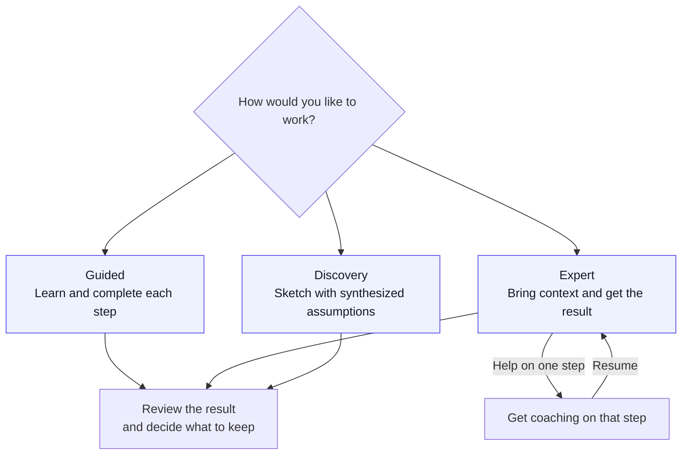

# Skills

A skill gives your AI assistant instructions for working through a Productside Playbook Play with you. Choose one below. Each Play folder contains only `SKILL.md`, with instructions, a working template, compact examples, and quality checks in that file.

For a chat, attach the chosen Play's `SKILL.md`, then describe your product and the help you need. Ask: "Walk me through this one question at a time."

For an agent tool that supports skill folders, use the complete `ps-...` folder and follow that tool's installation instructions.

Every skill supports **Guided** (learn and complete the work step by step, with context-relevant recommendations), **Expert** (bring context and get the result, with guidance on any step when needed), and **Discovery** (synthesize missing context and quickly sketch or simulate a walkthrough). The assistant reuses supplied context and hands decisions back to you. Discovery assumptions stay labeled; this interaction mode is distinct from the Blueprint's Discover phases and does not claim research was conducted.

Switch modes when needed; keep the context already supplied. A Discovery result remains provisional until its assumptions are validated.

For copy-and-paste prompts, use the separate [prompt collection](../prompts/README.md). No prompts or source PDFs are duplicated inside the skill folders.

25 skills cover all 24 numbered Plays, plus a Blueprint navigator and Storyboarding. The Outcome Tree covers two numbered Plays. Numbers follow the November 2026 B2B work-in-progress Playbook, which is not yet ratified.

### Navigator (cross-phase)

| Directory | Template | Type |
|---|---|---|
| [ps-blueprint-advisor](ps-blueprint-advisor/SKILL.md) | Blueprint (pages 1-3) | process |

### Context

| Directory | Template | Type |
|---|---|---|
| [ps-outcome-strategy-discussion](ps-outcome-strategy-discussion/SKILL.md) | 01 | process |
| [ps-stakeholder-alignment](ps-stakeholder-alignment/SKILL.md) | 02 | component |
| [ps-outcome-tree](ps-outcome-tree/SKILL.md) | 03 + 23 | component |
| [ps-market-selection-sizing](ps-market-selection-sizing/SKILL.md) | 04 | component |

### Discover + Investigate

| Directory | Template | Type |
|---|---|---|
| [ps-jobs-to-be-done](ps-jobs-to-be-done/SKILL.md) | 05 | component |
| [ps-proto-persona](ps-proto-persona/SKILL.md) | 06 | component |
| [ps-empathy-interviews](ps-empathy-interviews/SKILL.md) | 07 | process |
| [ps-affinity-mapping](ps-affinity-mapping/SKILL.md) | 08 | process |
| [ps-problem-identification](ps-problem-identification/SKILL.md) | 09 | component |
| [ps-framing-the-problem](ps-framing-the-problem/SKILL.md) | 10 | component |

### Discover + Define

| Directory | Template | Type |
|---|---|---|
| [ps-exploring-solution-space](ps-exploring-solution-space/SKILL.md) | 11 | process |
| [ps-solution-hypothesis](ps-solution-hypothesis/SKILL.md) | 12 | component |
| [ps-positioning-statement](ps-positioning-statement/SKILL.md) | 13 | component |
| [ps-lofi-experimentation](ps-lofi-experimentation/SKILL.md) | 14 | component |
| [ps-storyboarding](ps-storyboarding/SKILL.md) | none (instruction page only) | component |
| [ps-risk-assessment](ps-risk-assessment/SKILL.md) | 15 | component |
| [ps-product-outcome-canvas](ps-product-outcome-canvas/SKILL.md) | 16 | component |

### Create

| Directory | Template | Type |
|---|---|---|
| [ps-outcome-roadmap](ps-outcome-roadmap/SKILL.md) | 17 | component |
| [ps-tiny-acts-discovery](ps-tiny-acts-discovery/SKILL.md) | 18 | process |
| [ps-output-prioritization](ps-output-prioritization/SKILL.md) | 19 | component |
| [ps-go-to-market](ps-go-to-market/SKILL.md) | 20 | component |
| [ps-product-readiness](ps-product-readiness/SKILL.md) | 21 | component |

### Deliver

| Directory | Template | Type |
|---|---|---|
| [ps-measuring-outcomes](ps-measuring-outcomes/SKILL.md) | 22 | component |
| [ps-process-retrospective](ps-process-retrospective/SKILL.md) | 24 | process |
